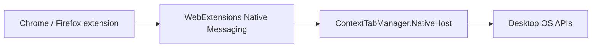

# ADR 0001: Use WebExtensions Native Messaging for the desktop companion

- Status: Accepted
- Date: 2026-11-09
- Updated: 2026-11-11

## Context

Desktop Focus needs OS-level window operations that a browser extension cannot perform. Candidate mechanisms included localhost HTTP, a permanently running daemon/tray process, and WebExtensions Native Messaging.

## Decision

Use browser Native Messaging with a small .NET native host.

The host executable and JSON protocol are shared across browsers. Browser-specific installation supplies the appropriate native manifest and registration:

- Chrome uses `allowed_origins`;
- Firefox uses `allowed_extensions`.

The Windows installer registers the host per user and restricts each native manifest to the exact extension/add-on ID.

## Rationale

Native Messaging avoids a listening TCP port, custom authentication, and permanent process lifetime while providing explicit browser-managed extension-to-host allowlisting.

## Consequences

Positive:

- smaller local attack surface than a general localhost API;
- browser-controlled host lifetime;
- clear browser/OS boundary;
- the same native executable works for Chrome and Firefox.

Negative:

- installation requires browser-specific registration;
- development builds must use stable/known browser extension IDs;
- each additional browser may require its own native manifest/registration rules.

## Rejected alternatives

**Localhost HTTP** was rejected because it introduces port management, authentication/origin concerns and daemon lifecycle.

**Arbitrary shell execution** was rejected because a general command runner is unnecessary and materially increases risk.
