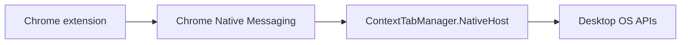

# ADR 0001: Use Chrome Native Messaging for the desktop companion

- Status: Accepted
- Date: 2026-11-09

## Context

Desktop Focus needs OS-level window operations that a Chrome extension cannot perform. Candidate mechanisms included localhost HTTP, a permanently running daemon/tray process, and Chrome Native Messaging.

## Decision

Use Chrome Native Messaging with a small .NET native host.

The Windows installer registers the host per-user and restricts `allowed_origins` to the exact extension ID.

## Rationale

Native Messaging avoids a listening TCP port, custom authentication, and permanent process lifetime while providing an explicit extension-to-host allowlist.

## Consequences

Positive: smaller local attack surface, Chrome-controlled host lifetime, and a clear browser/OS boundary.

Negative: OS-specific installation is required and unpacked builds must supply their extension ID.

## Rejected alternatives

**Localhost HTTP** was rejected because it introduces port management, authentication/origin concerns and daemon lifecycle.

**Arbitrary shell execution** was rejected because a general command runner is unnecessary and materially increases risk.
