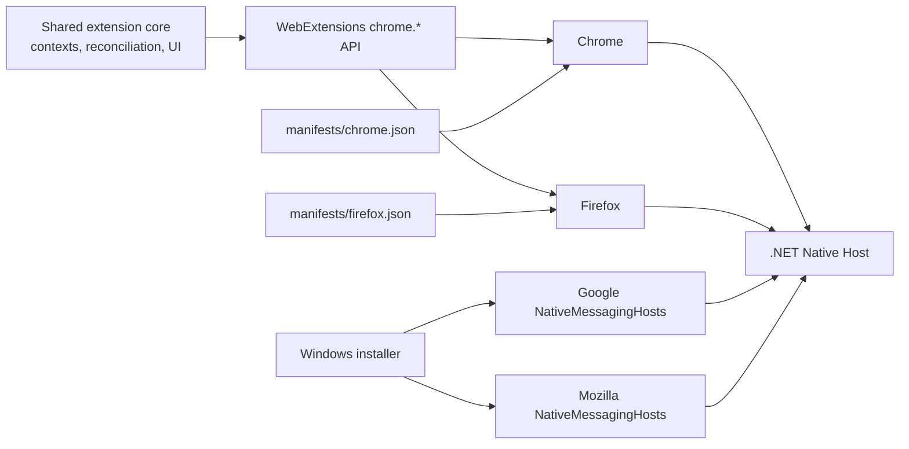
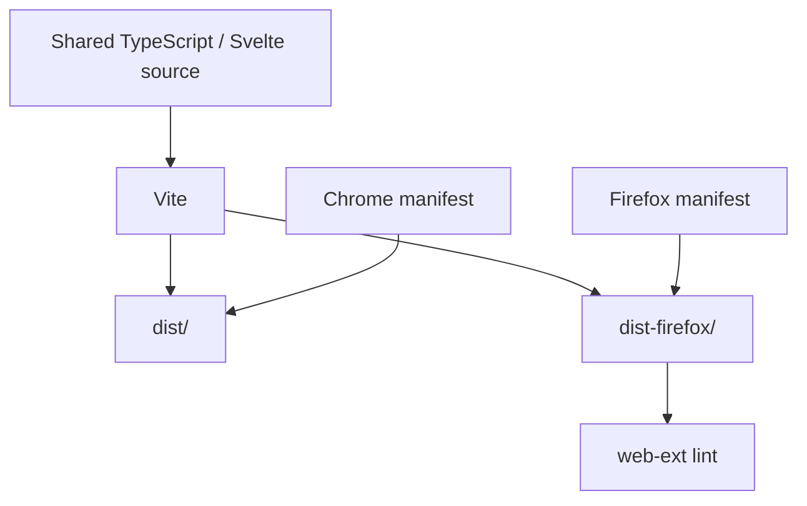

# Browser Portability Architecture

## Goal

Context Tab Manager supports Chrome and Firefox from one shared TypeScript/Svelte codebase.

Browser-specific behavior is intentionally restricted to:

- extension manifests and background execution model;
- build output/package validation;
- Native Messaging registration and allowlisting.

The context domain, persistence model, tab/window reconciliation, popup UI, search, shelving, switching and Desktop Focus protocol remain shared.

## Runtime architecture



Firefox exposes the Chromium-compatible `chrome.*` WebExtensions namespace, so the shared implementation keeps the existing API calls. Browser-specific branching is not added to the domain or reconciliation services unless an API behavior difference is actually observed in testing.

## Background execution

Chrome Manifest V3 uses an extension service worker:

```json
"background": {
  "service_worker": "service-worker.js",
  "type": "module"
}
```

Firefox Manifest V3 uses a non-persistent background script/event page:

```json
"background": {
  "scripts": ["service-worker.js"],
  "type": "module"
}
```

Both run the same bundled entry point.

## Build outputs



Commands:

- `npm run build:chrome` → `dist/`
- `npm run build:firefox` → `dist-firefox/`
- `npm run build:all` → both
- `npm run lint:firefox` → Mozilla `web-ext lint`

The default `npm run build` remains the Chrome build for backward compatibility.

## Firefox identity

Firefox uses the stable extension ID:

`context-tab-manager@g-nogueira.local`

The same ID is used in:

- `browser_specific_settings.gecko.id`;
- the Firefox Native Messaging manifest `allowed_extensions` list;
- Windows companion installation/diagnostics defaults.

The Firefox manifest declares no data collection:

```json
"data_collection_permissions": {
  "required": ["none"]
}
```

## Native Messaging

The .NET host and JSON protocol are shared between browsers.

Windows registration differs:

| Browser | Registry key |
| --- | --- |
| Chrome | `HKCU\Software\Google\Chrome\NativeMessagingHosts\com.gnogueira.context_tab_manager` |
| Firefox | `HKCU\Software\Mozilla\NativeMessagingHosts\com.gnogueira.context_tab_manager` |

Chrome's native manifest uses `allowed_origins`. Firefox's uses `allowed_extensions`.

Install Firefox registration:

`./native/ContextTabManager.NativeHost/install-windows.ps1 -Browser Firefox`

Install both browsers:

`./native/ContextTabManager.NativeHost/install-windows.ps1 -Browser Both -ChromeExtensionId <chrome-id>`

Diagnose Firefox registration:

`./native/ContextTabManager.NativeHost/diagnose-windows.ps1 -Browser Firefox`

## Local Firefox testing

1. Run `npm run build:firefox`.
2. Open `about:debugging#/runtime/this-firefox`.
3. Choose **Load Temporary Add-on…**.
4. Select `dist-firefox/manifest.json`.
5. Install/register the native host with `-Browser Firefox`.
6. Reload the temporary extension from `about:debugging`.
7. Verify companion health and then test Restore, Switch, Focus, Shelve, tab cleanup and multi-window context behavior.

## State migration

Browser extension storage is browser-local. Installing the Firefox build does not automatically import contexts stored by Chrome.

Cross-browser context export/import is deliberately separate from runtime compatibility and should be implemented as a dedicated migration feature if needed.
