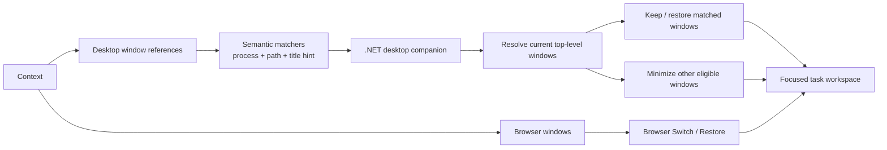
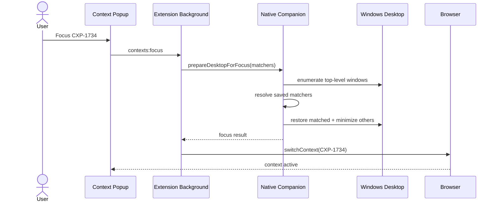

# Desktop Windows in Contexts

## Goal

A context represents the windows required for a task, not only browser tabs/windows.

A context can therefore contain:

- persistent browser-window snapshots managed by the WebExtension;
- persistent desktop-window references resolved by the native companion.

## Architecture



Browser windows retain the existing persistent `ContextWindow` model. Desktop members are additive and deliberately do not reuse browser-window identity.

## Focus sequence



The desktop preparation intentionally happens before browser Switch. The companion can minimize every unrelated browser window without needing to understand browser context membership; the extension then restores only the target context.

## Persistent identity

A desktop member stores:

```text
applicationName
displayName
matcher
  processName
  executablePath? 
  titleHint
```

It does **not** store:

- HWND;
- PID;
- foreground position;
- process lifetime state.

HWND/PID are transient and resolved only inside the native companion.

## Matcher resolution

Windows matching is conservative:

1. process name must match;
2. executable-path equality increases confidence when available;
3. normalized window-title equality/containment has high confidence;
4. token similarity permits small title changes;
5. matches below the confidence threshold are unresolved rather than guessed.

Each saved matcher can resolve at most one live desktop window per Focus operation.

## Window discovery

`listDesktopWindows` returns eligible visible top-level application windows.

Known browser processes are excluded from the picker because browser windows are already represented by `ContextWindow`. They are still eligible to be minimized by Desktop Focus.

## Missing members

A saved desktop member survives application/window closure. If it cannot be resolved during Focus, the companion leaves it unresolved and continues focusing the rest of the context.

Launching missing applications or workspaces is explicitly outside this first version.

## Cross-browser behavior

Chrome and Firefox share the same desktop-member model and Native Messaging protocol. The browser-specific registration implemented in the portability layer launches the same .NET companion.
