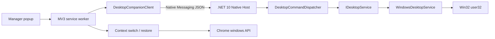
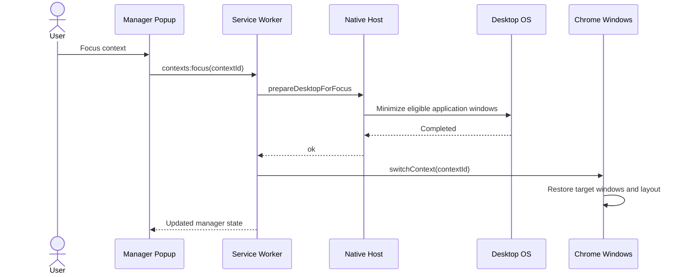

# Desktop Focus Architecture

## Goal

Desktop Focus extends a browser context into a desktop-level focus action without turning the Chrome extension into an OS-specific window manager.

The user-facing semantics are:

- **Restore**: recreate/show the selected context without intentionally minimizing other Chrome windows.
- **Switch**: show the selected context and minimize other Chrome windows.
- **Focus**: ask the native companion to minimize eligible desktop application windows, then run the existing Chrome **Switch** behavior.

The extension remains fully usable when the companion is not installed. Only **Focus** is unavailable.

## Component architecture

The key boundary is `IDesktopService`. The extension and Native Messaging protocol express product intentions; platform-specific APIs remain behind the native-host application boundary.

## Focus sequence

The native operation deliberately runs first. It may minimize every Chrome window, including the one that opened the popup. The MV3 service worker then restores only the selected context using the existing persisted Chrome window state and bounds.

## Native protocol

Host name: `com.gnogueira.context_tab_manager`.

| Command | Purpose |
| --- | --- |
| `getStatus` | Health/liveness round-trip; reports host version, protocol version, platform and capabilities. |
| `getCapabilities` | Backward-compatible capability-only response. |
| `prepareDesktopForFocus` | Prepares the desktop for a context Focus operation. |

There is no arbitrary process execution, shell command, path argument, process name argument, or raw OS-window handle in the protocol.

## Platform abstraction

`IDesktopService` exposes only `GetCapabilities()` and `PrepareForFocusAsync()`.

Current implementation:

- Windows: `WindowsDesktopService` using Win32 `EnumWindows` + `ShowWindowAsync(SW_MINIMIZE)`.
- macOS: unsupported placeholder.
- Linux: unsupported placeholder.

Future implementations can have different mechanics without changing the extension protocol. This matters for environments such as Wayland where arbitrary control of other applications may be intentionally restricted.

## Windows filtering

The Windows implementation enumerates visible top-level windows and excludes the desktop shell/taskbars, the native host itself, tool/no-activate windows, and owned windows unless explicitly marked as application windows.

## Failure behavior

The popup calls `getStatus` as an explicit health probe. A healthy response proves that Chrome could launch the registered Native Messaging host, exchange a correctly framed message and receive a valid application response. The status includes host version, protocol version, platform and Focus capability.

Without a working companion, normal extension operations continue working. **Focus** is disabled after status detection, while **Switch**, **Restore**, **Shelve**, search and organization remain extension-only.

## Windows development install

1. Build/load the unpacked extension and copy its ID from `chrome://extensions`.
2. Run `./native/ContextTabManager.NativeHost/install-windows.ps1 -ExtensionId <extension-id>`.
3. Reload the extension.

The installer publishes a self-contained single-file host under Local AppData, writes a Native Messaging manifest restricted to that extension ID, and registers it under `HKCU`.

If the popup reports the companion as unavailable or unhealthy, run:

`./native/ContextTabManager.NativeHost/diagnose-windows.ps1 -ExtensionId <extension-id>`

The diagnostic verifies:

1. the HKCU Native Messaging registration;
2. the registered manifest path and JSON;
3. the exact `allowed_origins` entry for the extension;
4. the native-host executable path;
5. a direct Native Messaging-framed `getStatus` request/response.

This separates Chrome registration problems from host/process/protocol failures. The popup also displays the raw Native Messaging failure reason inline and provides a **Retry** action.

To uninstall, run `./native/ContextTabManager.NativeHost/uninstall-windows.ps1`.

## Deliberately deferred

- restoring unrelated applications after leaving Focus;
- macOS/Linux implementations;
- configurable application allow/deny lists;
- desktop window positioning outside Chrome;
- daemon/localhost APIs.
