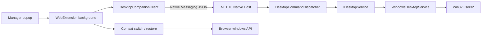
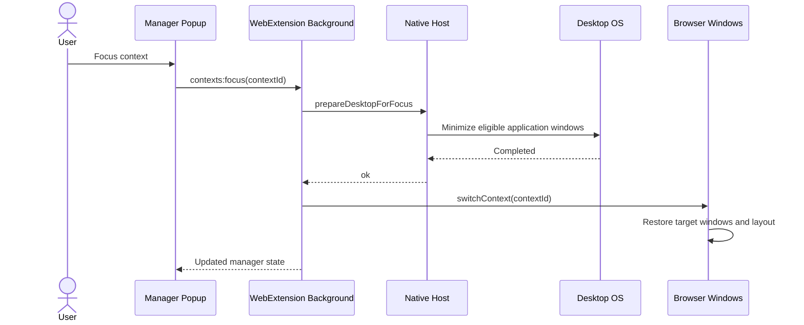

# Desktop Focus Architecture

## Goal

Desktop Focus extends a browser context into a desktop-level focus action without turning the extension into an OS-specific window manager.

The user-facing semantics are:

- **Restore**: recreate/show the selected context without intentionally minimizing other browser windows.
- **Switch**: show the selected context and minimize other browser windows.
- **Focus**: ask the native companion to minimize eligible desktop application windows, then run the existing browser **Switch** behavior.

The extension remains fully usable when the companion is not installed. Only **Focus** is unavailable.

## Component architecture



Chrome runs the shared background bundle as a Manifest V3 service worker. Firefox runs the same bundle as a non-persistent background script/event page.

The key boundary is `IDesktopService`. The extension and Native Messaging protocol express product intentions; platform-specific APIs remain behind the native-host application boundary.

## Focus sequence



The native operation deliberately runs first. It may minimize every browser window, including the one that opened the popup. The extension background process then restores only the selected context using the existing persisted browser window state and bounds.

## Native protocol

Host name: `com.gnogueira.context_tab_manager`.

| Command | Purpose |
| --- | --- |
| `getStatus` | Health/liveness round-trip; reports host version, protocol version, platform and capabilities. |
| `getCapabilities` | Backward-compatible capability-only response. |
| `prepareDesktopForFocus` | Prepares the desktop for a context Focus operation. |

There is no arbitrary process execution, shell command, path argument, process name argument, or raw OS-window handle in the protocol.

## Platform abstraction

`IDesktopService` exposes only `GetCapabilities()` and `PrepareForFocusAsync()`.

Current implementation:

- Windows: `WindowsDesktopService` using Win32 `EnumWindows` + `ShowWindowAsync(SW_MINIMIZE)`.
- macOS: unsupported placeholder.
- Linux: unsupported placeholder.

Future implementations can have different mechanics without changing the extension protocol.

## Browser registration

The native executable and protocol are shared, but browser registration differs.

| Browser | Native manifest allowlist | Windows registry |
| --- | --- | --- |
| Chrome | `allowed_origins` | `HKCU\Software\Google\Chrome\NativeMessagingHosts\...` |
| Firefox | `allowed_extensions` | `HKCU\Software\Mozilla\NativeMessagingHosts\...` |

Firefox uses the stable add-on ID `context-tab-manager@g-nogueira.local`.

## Failure behavior

The popup calls `getStatus` as an explicit health probe. A healthy response proves that the active browser could launch the registered Native Messaging host, exchange a correctly framed message and receive a valid application response.

Without a working companion, normal extension operations continue working. **Focus** is disabled after status detection, while **Switch**, **Restore**, **Shelve**, search and organization remain extension-only.

## Windows development install

### Chrome

```powershell
./native/ContextTabManager.NativeHost/install-windows.ps1 `
  -Browser Chrome `
  -ChromeExtensionId <chrome-extension-id>
```

### Firefox

```powershell
./native/ContextTabManager.NativeHost/install-windows.ps1 -Browser Firefox
```

### Both

```powershell
./native/ContextTabManager.NativeHost/install-windows.ps1 `
  -Browser Both `
  -ChromeExtensionId <chrome-extension-id>
```

Diagnostics use the same `-Browser` parameter.

## Companion diagnostics

Health and Focus calls carry a short correlation/request ID through:

```text
popup DevTools
  → WebExtension background debugger
    → Native Messaging client
      → .NET native host
```

Extension logs use the prefix `[ContextTabManager]` and include the request ID, command, timing and result/error.

The native host also appends to:

`%LOCALAPPDATA%\ContextTabManager\NativeHost\logs\native-host.log`

On Windows, tail it while clicking **Retry**:

```powershell
Get-Content "$env:LOCALAPPDATA\ContextTabManager\NativeHost\logs\native-host.log" -Tail 50 -Wait
```

The same request ID should appear in the background console and native log. If the background process logs `send:dispatched` but the ID never appears in the native log, the browser did not launch/reach the registered host. If the ID reaches the native log and a response is logged but the extension times out, the failure is on the browser return path.

## Deliberately deferred

- restoring unrelated applications after leaving Focus;
- macOS/Linux desktop implementations;
- configurable application allow/deny lists;
- desktop window positioning outside the managed browser;
- daemon/localhost APIs.
